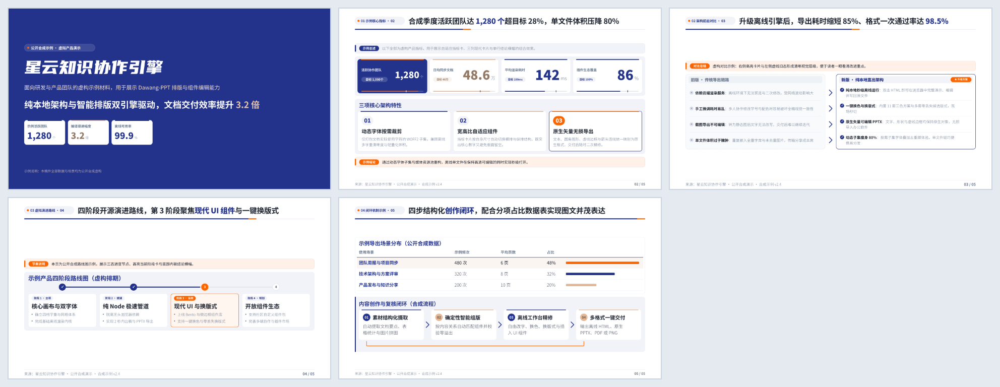

# Dawang-PPT

**Pure-Node Fast Presentation Engine · Modern Web UI Aesthetics · Zero-Lag Offline HTML Studio · Native Editable PPTX Export**

Turn raw notes, spreadsheets, screenshots, and business reports into a **single self-contained offline-editable HTML Studio** and a **native editable PPTX** in seconds. Recipients can open the delivered HTML directly in Chrome/Edge with zero installation to edit text, drag/align elements, switch palettes or layouts in one click, insert modern UI components, and export to PPTX/PDF/PNG.

[中文文档](README.md) · [Installation & Usage](docs/USAGE.md) · [Showcase](docs/SHOWCASE.md) · [Authoring Approach](docs/APPROACH.md)



## Key Highlights

- **Modern Web UI Component System (100% Native PPTX Editable):** Inspired by **Tremor, shadcn/ui, Magic UI, Aceternity UI, Linear, and Stripe**. Includes aspect-ratio-aware KPI cards (`renderMetricCard` / `metricBento`) with target pills & mini progress ticks, pill eyebrow badges, inline Callout verdict banners, SaaS dashed-vs-solid contrast comparisons, 3-state milestone steppers, and flywheel flows.
- **Refined 4-Weight Dual Typography:** Bundles **Source Han Sans SC (300 / 400 / 700 / 900)** + **YouSheBiaoTiHei**, calibrated with bold accent headings, crisp `11pt` 300-Light muted body text, and 900-Heavy expressive figures.
- **Offline Studio v4 Editor (`file://` Ready):**
  - **One-Click Per-Slide Layout Switcher** with strict **Zero-Content-Loss verification** across every candidate layout (`⌘Z` undo supported).
  - **One-Click 11 Three-Tone Palettes** (9 light + 2 dark flagship themes), automatically remapping every slide and every stored layout variant.
  - **Topbar `+ UI组件` Quick-Insert Menu** with 8 ready-to-use modern UI presets that inherit the active palette.
  - **Figma-style Canvas:** marquee multi-select, smart snapping & distribution, in-place image cropping, and 80% smaller single-file HTML via dynamic font subsetting & deduplicated asset pooling.
- **Sub-2s Pure-Node Pipeline:** Zero headless Chrome needed for composition or PPTX generation (`dawang.mjs ingest` → `dawang.mjs fast:build`).


## Quick Start

Requires Node.js 22+ (primarily tested on macOS + Chrome). Viewers/editors of delivered HTML files need no installation at all.

```sh
git clone https://github.com/mujingquan835/Dawang-ppt.git
cd Dawang-ppt/skills/dawang-ppt
npm ci --prefix project
node scripts/install.mjs
node scripts/dawang.mjs doctor
```

Once `doctor` reports `ready: true`, invoke `dawang-ppt` in your AI coding agent (Claude Code, Codex, Cursor, Antigravity) or build directly via CLI:

```sh
node skills/dawang-ppt/scripts/dawang.mjs fast:build "<outline.json>" "<out.html>" --pptx "<out.pptx>" --preview "<preview.png>"
```

See [README.md](README.md), [USAGE.md](docs/USAGE.md), [LICENSE](LICENSE), and [NOTICE.md](NOTICE.md) for full details.
