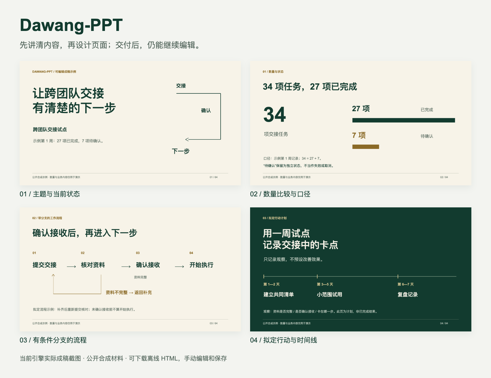
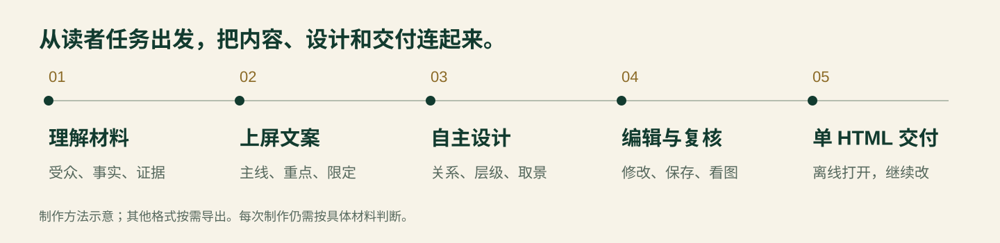
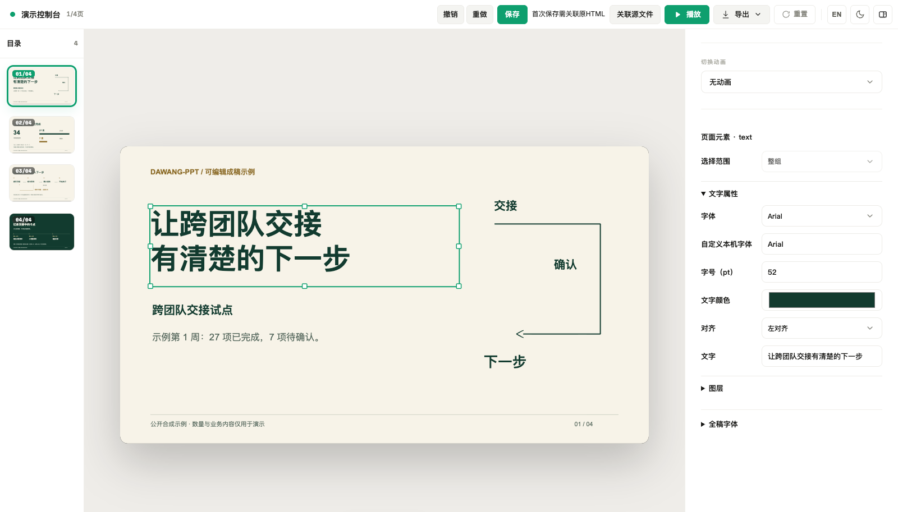
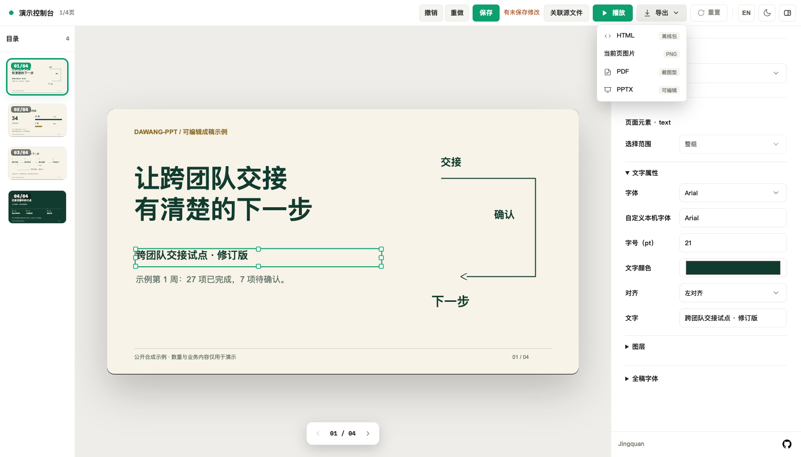

# Dawang-PPT

**先讲清内容，再设计页面；交付后，仍能继续编辑。**

把原文、数据、截图和需求交给 AI，经过材料理解、文案提炼、逐页设计和复核，得到一个可离线打开、编辑、保存的 HTML 演示文稿。需要时再导出 PPTX、PDF 或图片。

[下载可编辑示例](https://github.com/mujingquan835/Dawang-ppt/releases/download/v0.2.0-preview.20261104/dawang-ppt-editable-showcase.html) · [安装与第一份稿件](docs/USAGE.md) · [完整图片示例](docs/SHOWCASE.md) · [制作思路](docs/APPROACH.md)



> 上图是当前引擎的实际成稿截图。内容与数字均为公开合成材料，用于展示表达和编辑能力，不代表真实业务结果。每一页的文字、图形和线条可继续编辑；这只是一个视觉实例，制作时仍按材料自主设计。

## 先选一条上手路径

| 你现在想做什么 | 从这里开始 |
|---|---|
| 先看效果，手动改一页试试 | [下载示例 HTML](https://github.com/mujingquan835/Dawang-ppt/releases/download/v0.2.0-preview.20261104/dawang-ppt-editable-showcase.html)，用 Chrome / Edge 打开。无需 Node.js、AI 账号或 skill 安装 |
| 让 AI 根据自己的材料制作 | 先准备 Node.js 22+、本地 AI 客户端和**匹配的完整规则资料**，再按[安装说明](docs/USAGE.md)配置 |
| 理解怎么提需求、怎么把稿件做好 | 阅读[制作思路](docs/APPROACH.md)与[案例拆解](docs/SHOWCASE.md) |

**安装前先知道：**公开 skill ZIP 不附未获再分发许可的完整规则原文。AI 新稿制作须另外合法取得并配置匹配资料，`doctor` 显示 `ready: true` 才算就绪。没有资料时可以先体验示例 HTML 的查看和手动编辑；[资料结构与配置步骤在这里](docs/USAGE.md#4-配置完整规则资料并检查)。

## 它适合怎样的工作

| 场景 | 可以提供的材料 | 页面重点 |
|---|---|---|
| 经营汇报、项目复盘 | 原始记录、数据、问题、下一步 | 讲清状态、证据、差距和行动，保留单位与时期 |
| 产品介绍、方案提案 | 产品说明、真实截图、适用范围 | 讲清谁如何使用、具体价值及其依据 |
| 技术方案、流程说明 | 架构、机制、条件、测试示例 | 画清依赖与分支，区分已实现、已验证和计划 |
| 培训与知识分享 | 教程、步骤、案例、常见错误 | 帮读者理解、记住并正确操作 |

Dawang-PPT 是 AI 客户端中的本地制作 skill。模型、账号与权限由你使用的客户端提供；内容策划和设计由制作智能体完成，程序负责可编辑工程、渲染、检查、保存与导出。

## 我们怎么做一份稿件



- **从读者任务开始。** 先确定谁看、看完需要理解或决定什么，再组织主线和逐页重点。
- **先写能上屏的文案。** 保留有力原句，把零散材料提炼成具体主张；事实、数字、条件与待核状态跟着表达走。
- **让内容关系决定构图。** 数量适合比较，步骤需要流程，计划可以用时间线；截图保留必须辨认的区域，布局不锁死在一种模板里。
- **交付后还能改。** HTML 保留可移交工程和资源；同事可以继续改字、移动对象、调整样式并保存。
- **程序检查与实际看图一起做。** 不只检查文件生成成功，还要看重点是否清楚、图文是否可读、证据和限定是否保留。

[展开看：内容编辑、素材取舍和复核方法 →](docs/APPROACH.md)

## 看看实际编辑器



| 位置或动作 | 用法 |
|---|---|
| 左侧目录 | 切换页面，查看全稿结构 |
| 画布上的文字或图形 | 单击选择、拖动移动，用控制点缩放；双击文字进入编辑 |
| 右侧属性栏 | 调整所选对象的字体、字号、颜色等属性 |
| 顶部撤销 / 重做 | 回退修改或恢复操作 |
| 顶部保存 | 第一次选择当前已经存在的原 HTML 并授权，之后写回同一文件 |

保存前确认选的是当前原文件；只有成功写入后才显示已保存。浏览器草稿和“导出 HTML 副本”不等同于原文件保存。重开、换浏览器或移动文件后，可能需要再次关联。

[查看改字、保存和导出的分步图片 →](docs/SHOWCASE.md#实际操作图解)

## 从第一份材料开始

当前 skill 分享版是 [`v0.2.0-preview.20261104`](https://github.com/mujingquan835/Dawang-ppt/releases/tag/v0.2.0-preview.20261104)，属于预发布。下载该页的专用 skill ZIP，解压到长期保留的位置；以下命令在解压后的 `dawang-ppt` 文件夹中执行：

```sh
npm ci --prefix project
node scripts/install.mjs
export DAWANG_PPT_RULES_DIR="/你的实际路径/完整规则目录"
node scripts/dawang.mjs doctor
```

确认 `runtime: true`、`rules.status: "pinned"`、`ready: true`。桌面客户端不一定继承终端环境变量，具体配置及其他客户端入口见[详细说明](docs/USAGE.md)。主要实测环境为 macOS + Chrome；Windows / Linux 完整制作链路仍需分别验证。

新开 AI 会话，附上材料，然后这样说：

> 使用 dawang-ppt，将附件制作成 6 页管理汇报，面向部门负责人。先提炼每页主张和可上屏文案，再自主设计。保留数据单位、时期、来源和待核状态，不补造事实。逐页看图复核，默认交付一个可离线编辑、保存的 HTML。

已有稿件可以这样改：

> 使用 dawang-ppt，基于这份保存后的 HTML，放大第 3 页流程图并调整标题，其余文案和布局保持不变，保留已有人工编辑。

## 一个 HTML，按需选择其他格式



| 格式 | 适合什么 | 需要知道 |
|---|---|---|
| HTML | 离线演示、手动编辑、继续交接 | 默认交付，内嵌工程和必要资源 |
| PPTX | 在 PowerPoint 等工具中继续编辑 | 文字、图片、基础形状等保持对应编辑能力；字体不嵌入，目标客户端需复核 |
| PDF | 固定版面发送、打印 | 截图型 PDF，正文不可按普通文本选择 |
| PNG | 单页预览、群聊或插入文档 | 静态图片 |

不承诺原生数据图表、SmartArt、任意 PPTX 模板或网页无损导入、跨客户端像素一致。内容质量受材料与模型判断影响；实际稿件仍需内容和视觉复核，不承诺固定制作时长。

## 继续了解

[详细安装与排错](docs/USAGE.md) · [四页示例与可复用源材料](docs/SHOWCASE.md) · [制作思路](docs/APPROACH.md) · [规则完整性对照](docs/RULES-PARITY.md) · [版本记录](docs/RELEASE-20261027.md) · [English](README.en.md)

源码维护者可运行 `npm ci`、`npm ci --prefix skills/dawang-ppt/project` 和 `npm test`。案例的重新生成与截图方法见 [examples/showcase](examples/showcase/README.md)。公开示例只使用合成材料，完整规则、历史源码与必要许可各按原边界维护。

[许可证](LICENSE) · [版权与来源](NOTICE.md)
