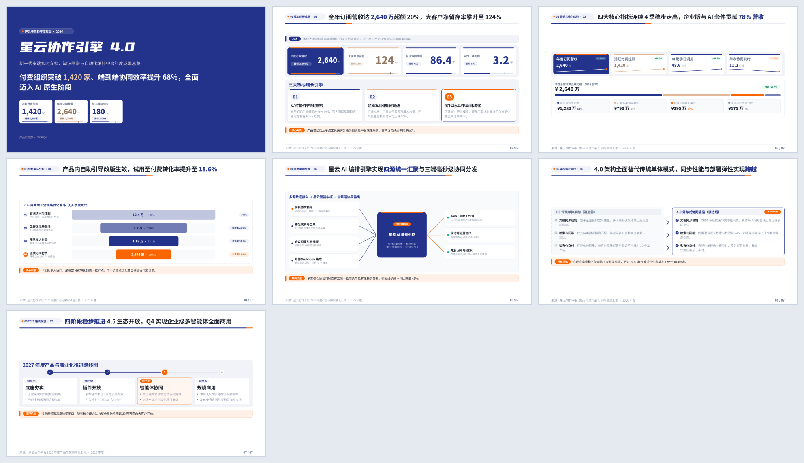

# Dawang-PPT

**极速纯 Node 中文演示组版引擎 · 现代网页 UI 级审美 · 离线零卡顿精修工作台 · 原生可编辑 PPTX 直出**

把原始文档、表格数据、现场截图与汇报要求交给 AI，通过极速纯 Node 确定性组版引擎一键生成**单文件离线可编辑 HTML 工作台**与**原生可编辑 PPTX**——无需云端服务，交付后同事仍可直接在浏览器里改字、拖图、一键换色、一键换版式、插入现代 UI 组件并无损导出。

[安装与快速上手](docs/USAGE.md) · [完整案例拆解](docs/SHOWCASE.md) · [设计制作思路](docs/APPROACH.md) · [English README](README.en.md)



> 上图为当前引擎实际生成的 5 页合成汇报总览图（内容与数字为公开合成演示材料，用于展示排版质感与组件能力）。每一页的文字、卡片、圆角形状、虚线边框、进度刻度条与连线均为原生矢量对象，HTML 离线可精修，PPTX 导出后可在 PowerPoint / WPS 中继续编辑。

---

## 核心特性一览

### 1. 现代网页 UI 级组件体系（100% PPTX 原生可编辑）
汲取 **Tremor / shadcn/ui / Magic UI / Aceternity UI / Linear / Stripe** 现代设计语言，全部由原生几何图形与多字重文本构建，告别传统“大色块土味 PPT”：
- **宽高比自适应 KPI 卡片引擎（`renderMetricCard` / `metricBento`）**：卡片按自身宽高比自动决策内部构图——横向宽卡自动切换「左指标名+目标胶囊｜右放大主数字」填满画幅；高区域多指标自动组合为重点放大的 Bento 网格，消除大面积留空，同时附带目标值小胶囊与迷你目标刻度进度条。
- **精致四字重双字体层级**：内置 **思源黑体（Source Han Sans SC）300 / 400 / 700 / 900 四档字重 + 优设标题黑（YouSheBiaoTiHei）**，严格贯彻「粗体主题色标题 + 11pt 300 细体中灰正文 + 900 特粗核心数字」的高级阅读层级。
- **全场景现代汇报组件**：圆点眉标胶囊、单行内联 Callout 结论横幅（`总述` / `核心判断`）、SaaS 虚线降权旧态 vs 主色抬升新态对比卡、Linear 三态节点里程碑时间轴、水印序号回流飞轮、占比进度条表格。

### 2. Dawang-PPT Studio 离线零卡顿精修工作台
交付的单个 `.html` 文件即是一个完整的轻量级在线演示编辑器（支持 `file://` 离线秒开，通过动态字体子集化与图片池化体积瘦身 **80%**）：


| 工作台能力 | 说明 |
|---|---|
| **一键切换当前页版式** | 右侧属性栏提供多套通过**零内容缺失校验**的候选版式（精修主版 / 现代卡片 / Bento 网格 / 左右焦点 / 极简导航等），0 毫秒切换、支持 `⌘Z` 撤销且保留微调 |
| **一键切换全稿 11 套配色** | 内置 9 套三色协同浅色方案（蓝金色、皓石金、商务金、翡翠金、绿红金、蓝青色、红金色、紫金橙、三原色）+ 2 套深色旗舰主题（星夜曜金、黑曜电青），**自动联动同步所有候选版式** |
| **顶部「UI组件」一键插入** | 工具栏支持现场一键插入 8 类现代 UI 组件（涨跌 KPI 卡、目标刻度进度条、结论横幅、状态胶囊、深浅焦点卡、对比双卡、三联诊断卡、里程碑条），自动跟随当前配色 |
| **Figma 级自由精修** | 拉框多选、智能吸附对齐与等距分布、双击直接改字、图片原地裁切、新建/复制/排序页面、全屏放映与源 HTML 覆盖保存 |

### 3. 极速纯 Node 管道 & 多格式按需导出
- **纯 Node 确定性极速出稿**：`dawang.mjs ingest` 一键摄取文件夹/DOCX/XLSX/PPTX/图片拼图；`dawang.mjs fast:build` 无需启动无头浏览器，**< 2 秒**同时产出离线可编辑 HTML、原生可编辑 PPTX 与单张全稿总览图（含实时 DOM 溢出检查）。
- **无头 IR 直出原生 PPTX**：所有文本、多字重富文本（runs）、圆角矩形、实线/虚线描边、箭头连线与裁剪图片均映射为原生 PPTX 对象（内置 ZIP 完整性校验）。

| 导出格式 | 适用场景 | 说明 |
|---|---|---|
| **HTML（默认交付）** | 离线演示、二次精修、团队交接 | 单文件自包含，WOFF2 动态子集字体 + 去重资源池，零外网依赖 |
| **PPTX** | PowerPoint / WPS 深度编辑与汇报 | 文字、形状、虚线边框、连线、图片均原生可编辑 |
| **PDF** | 固定版面发送与打印 | 高清静态版面输出 |
| **PNG** | 单页预览、群聊分享或插图 | 1080p 高清图片 |

---

## 快速安装与使用

环境要求：Node.js 22+（主要实测环境为 macOS + Chrome；离线打开交付的 HTML 无需 Node.js 或任何安装）。

```sh
git clone https://github.com/mujingquan835/Dawang-ppt.git
cd Dawang-ppt/skills/dawang-ppt
npm ci --prefix project
node scripts/install.mjs
node scripts/dawang.mjs doctor
```

确认输出 `ready: true` 后，在 AI 客户端（Claude Code / Codex / Cursor / Antigravity 等）中直接附上素材并说明需求即可，例如：

> 使用 dawang-ppt，把附件材料整理成一份 6 页季度工作汇报（蓝金色），先提炼核心结论与数据证据，生成离线可编辑 HTML 与原生 PPTX。

### 命令行一键极速构建（开发者 / 自动化流水线）

```sh
# 1. 一键摄取素材目录（自动提取文档/表格并生成单张图片总览拼图）
node skills/dawang-ppt/scripts/dawang.mjs ingest "<素材目录>" "<临时目录>"

# 2. 基于语义 outline.json 一键生成 HTML + PPTX + 视觉总览图
node skills/dawang-ppt/scripts/dawang.mjs fast:build "<outline.json>" "<输出.html>" --pptx "<输出.pptx>" --preview "<preview.png>"
```

---

## 适用场景

| 场景 | 可提供的原始材料 | 引擎自动重点表达 |
|---|---|---|
| **季度 / 年度工作汇报** | 原始数据、Excel 业绩表、活动现场图 | 核心 KPI 达成进度、关键增长动作、复盘结论 |
| **项目复盘与效能对比** | 优化前后记录、问题清单、改进措施 | 虚线旧态 vs 高亮新态对比、问题→归因→解法闭环 |
| **阶段排期与路线图** | 季度计划、里程碑节点、并行项目 | 三态节点时间轴、阶段状态胶囊与重点节奏判断 |
| **机制方案与增长飞轮** | 业务步骤、回流闭环、分项占比表 | 步骤卡片流 + 回流箭头 + 原位比例条数据表 |

---

## 继续了解

[详细安装与排错](docs/USAGE.md) · [四页示例与源材料](docs/SHOWCASE.md) · [制作思路](docs/APPROACH.md) · [规则完整性对照](docs/RULES-PARITY.md) · [English](README.en.md)

源码维护者可运行 `npm ci`、`npm ci --prefix skills/dawang-ppt/project` 与 `npm test`。

[许可证](LICENSE) · [版权与来源](NOTICE.md)
