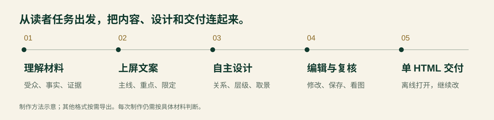
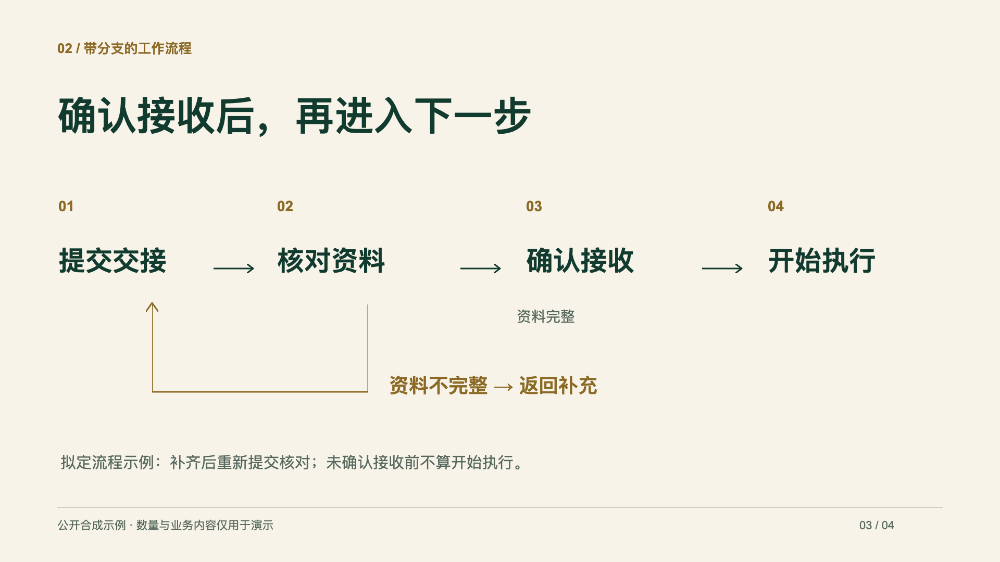

# Dawang-PPT 的制作思路

Dawang-PPT 把材料理解、表达编辑、页面设计与可编辑交付放在同一条流程里。这里解释现有方法，帮助使用者提需求、看稿件；完整制作仍执行既有规则与逐节适配机制。

## 先确定读者要得到什么

一份稿件开始前，明确谁会看、用在什么场合、看完要理解或决定什么。经营复盘需要判断与行动，培训需要步骤与自查，技术评审需要机制与条件；表达方式随读者任务调整。

材料中同时出现的内容不必同等突出。先确定全稿要回答的问题、每页的读者任务和重点主张，再分配证据、说明及必要限定。

## 排版前，先完成可上屏的文案

完整阅读材料后，保留准确有力的原句，合并重复解释，把过程或功能连接到读者能理解的意义。标题可以表达明确状态，也可以是步骤或问题，按页面职责选择。

本次合成案例把“34项任务中27项已完成、7项待确认”提炼为“34项任务，27项已完成”，同时把“待确认”独立呈现。数字、口径和状态完整保留；不能为了标题更有气势，把它改成“交接全面提效”。

文案分清原句、由事实提炼和AI新写。AI新写的定位或重点表达需要有依据，并列出供使用者确认。仅改排版或指定原文锁定时，编辑范围相应缩小，不重写已确认文案。

## 让关系决定页面结构

数量需要可比较的尺度，流程需要步骤和条件，时间计划需要顺序与阶段。构图使用对齐、留白、字号和色彩层级，让观众知道先看哪里，再看什么。

案例流程保留“资料不完整 → 返回补充”的分支；精简时不能把它改成始终顺利前进的四步直线。示例只是一个视觉方向，不是固定模板，也不要求以后都用4页、墨绿或同一种字号。

## 图片参与表达，取景保留证据

截图可以展示界面、解释动作或支持案例。先判断图片有什么独立信息，再选择完整展示或局部裁切；关键字段、主体、关系和必要上下文要保留。不要仅为填满页面添加图片。

产品介绍可以评估沿用真实界面的视觉语言。技术页可以让机制图和对应实例共同支撑主张；测试环境实例仍只证明该情境，不能据此宣称生产可靠性。

## 把交付做成可继续使用的文件

默认交付一个包含工程与资源的HTML。接收者在支持的浏览器中能继续改字、移动元素、调整样式并保存；AI后续修改也从保存后的稿件继续，保留已有人工编辑。

PPTX、PDF和图片按需输出。HTML的可继续编辑、PPTX对应对象的编辑能力、PDF的截图属性和字体兼容边界，都在交付时说清楚。

## 用三层复核判断是否完成

| 层次 | 看什么 |
|---|---|
| 程序检查 | 图像、字体、有效尺寸、越界、溢出、重叠与必要信息 |
| 内容检查 | 重点是否清楚，论点有无支撑，事实、单位、时期、条件与未知是否保留 |
| 实际看图与编辑 | 全稿节奏、逐页层级、截图可读性，以及修改、撤销、保存重开 |

文件生成成功是其中一项检查。实际效果还要结合原材料、读者任务和使用者反馈判断；不把程序检查通过当成视觉认可，也不承诺每次模型产出完全相同。

[看完整案例与操作图解](SHOWCASE.md) · [安装和排错](USAGE.md)
