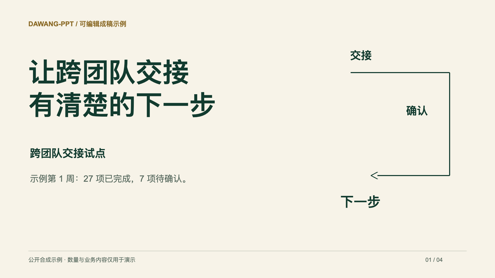
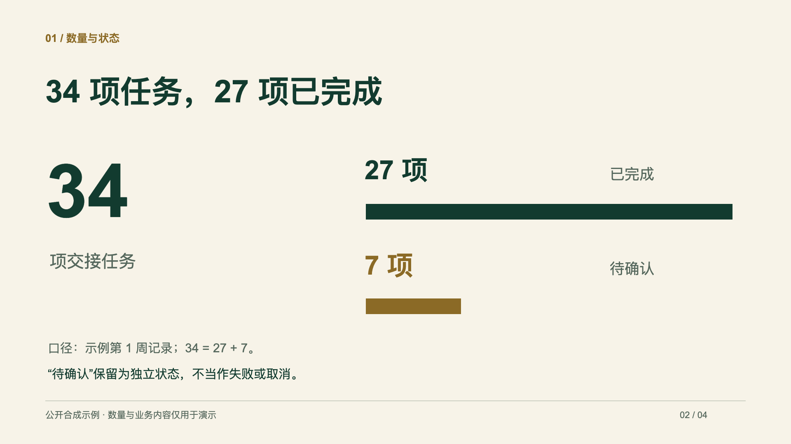
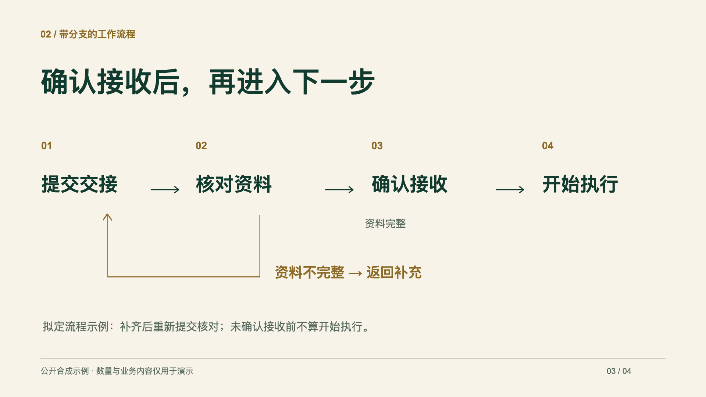
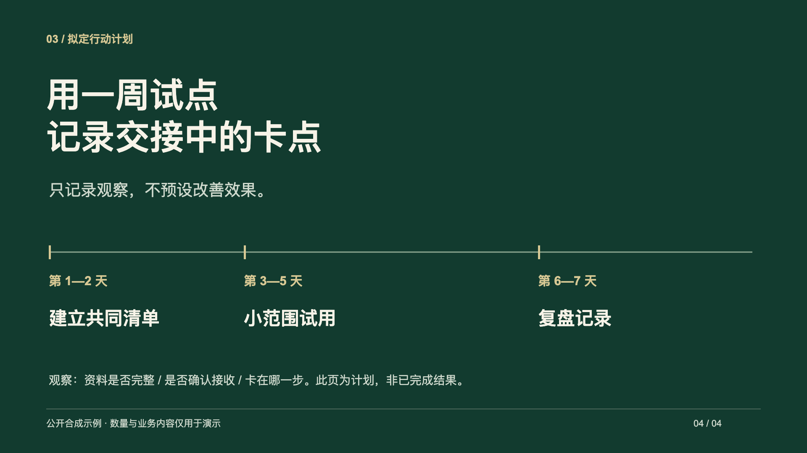
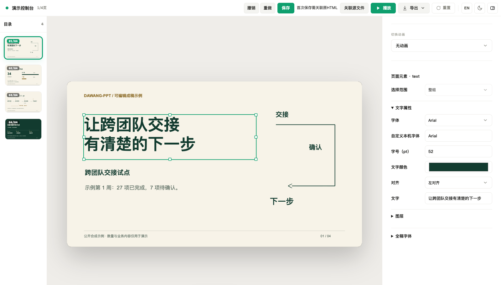
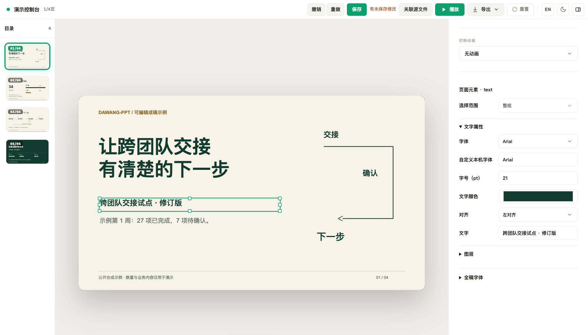
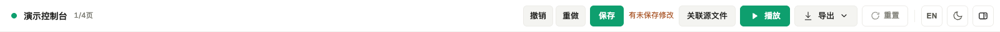
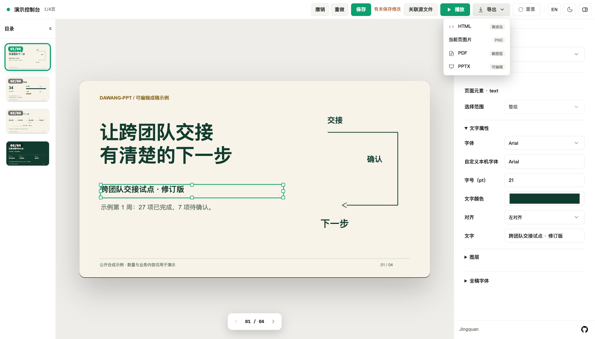

# 四页可编辑示例与操作图解

[下载示例 HTML](https://github.com/mujingquan835/Dawang-ppt/releases/download/v0.2.0-preview.20261027.1/dawang-ppt-editable-showcase.html) · [源材料](../examples/showcase/material.md) · [可复用工程输入](../examples/showcase/deck.mjs) · [重新生成](../examples/showcase/README.md)

示例主题为“跨团队交接试点”。全部业务内容与数字均为合成，仅展示表达、布局及编辑方式，不代表真实组织或产品带来的改善。页面和编辑器截图由当前发布代码实际生成；没有使用图片代替可编辑页面。

## 四种内容关系，四个页面

### 1. 主题与当前状态

用开放留白和字号差建立重点，封面直接保留示例记录中的状态；右侧图形呼应交接、确认与下一步。

### 2. 数量比较与口径

34项任务分为27项已完成和7项待确认，两条图形使用相同尺度。文字、数字和条形都是单独对象，可以继续编辑；这里展示的不是原生数据图表。

### 3. 保留异常分支的流程

完整资料才能进入确认接收，资料不足则返回补充；必要条件和分支保留在页面上。

### 4. 计划与观察边界

用时间线表达一周试点安排，并明确“拟定计划”和“不预设改善效果”。阶段长度有区别，按材料中的2天、3天、2天安排组织。

## 实际操作图解

以下为同一个示例HTML在浏览器中的实际画面。改字截图演示将副标题加上“修订版”，下载文件本身保留初始内容。

### 第一步：看目录，选择对象

左侧切换页面；画布中单击文字或图形选中，再拖动移动、用控制点缩放；右侧调整所选对象的属性。

### 第二步：双击文字，完成修改

双击进入文字编辑。示例中把“跨团队交接试点”改为“跨团队交接试点 · 修订版”；顶部撤销、重做可以回退或恢复。截图与脚本实际验证了这两个操作。

### 第三步：保存回当前原文件

第一次点击“保存”或按 `⌘S / Ctrl+S`，按提示选择当前已经存在的原HTML并授予写入权限。之后复用关联写回同一文件；重开或换环境可能需要再次授权。下图是实际顶部控件，不是文件选择对话框。

只有成功写入后才显示已保存。取消、选错文件或写入失败时保留页面修改，按提示处理；浏览器草稿不能代替原文件保存。

### 第四步：需要其他格式时，再导出

菜单中的HTML导出是下载副本；PPTX、PDF和当前页图片按需选择。导出副本不等于已保存原文件。

## 先试用，再决定是否安装

下载示例并用Chrome/Edge打开，即可查看和手动编辑，不需要安装skill或模型账号。让AI使用自己的材料新建稿件，需要按[使用说明](USAGE.md)配置客户端、运行依赖和匹配的完整规则资料；公开示例不附未获再分发许可的规则原文。

## 示例文案的来源

| 页面重点 | 来源 |
|---|---|
| 让跨团队交接有清楚的下一步 | AI依据合成材料新写，作为全稿定位和封面主张 |
| 34项任务，27项已完成 | 从合成数量记录提炼，保留7项待确认及口径 |
| 确认接收后，再进入下一步 | 从合成流程条件提炼 |
| 用一周试点记录交接中的卡点 | AI依据合成计划新写，保留计划状态及不预设效果 |

本案例为用户已授权的公开合成演示。AI新写措辞仅表达虚构案例的设定，不构成真实业务事实或产品成效保证。
