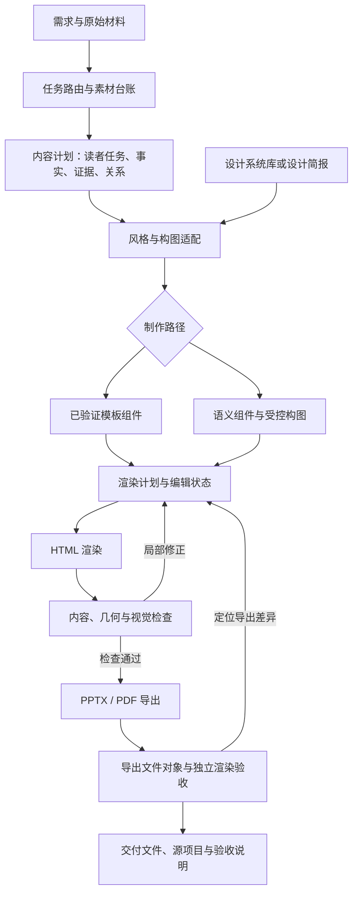

# Dawang-PPT｜PPT 技能融合方案

文档版本：规划稿 v1.0
编写日期：2026-10-13
项目名称：**Dawang-PPT**
拟用技能标识：`dawang-ppt`
状态：**供评审和后续开发使用，尚未实施本文所列架构与能力。**

本轮交付是一份完整开发规划。文中的目录、数据结构、模块和阶段版本均为拟议设计，不表示相关文件或功能已经创建。本轮不安装新技能，不修改现有 dashi/Kimi 技能，不执行迁移或回退。

## 1. 项目定位与目标

Dawang-PPT 是面向中文工作场景的、内容驱动的演示文稿制作技能。它吸收 open-kimi-ppt 的场景判断、内容组织、设计系统和视觉复核方法，复用并逐步改造 dashi-PPT 的页面组件、浏览器编辑、本地预览和可编辑 PPTX 导出能力。

项目的核心目标是：**先理解这一页要让读者明白什么，再选择表达结构和视觉语言，并依据实际渲染结果调整排版。**

项目成功不以新增主题数量衡量。至少要证明：同一份内容能使用不同风格合理表达；同一套风格能处理不同的信息关系；旧主题也能受益于新的规划与检查机制。

### 1.1 用户应感受到的变化

| 维度 | 当前主要方式 | Dawang-PPT 目标 |
|---|---|---|
| 内容处理 | 在模板字段范围内填写材料 | 先保全事实、证据和必须展示的内容，再组织页面 |
| 页面选择 | 挑一个看起来接近的版式 | 依据比较、趋势、流程、案例、明细等关系选择结构 |
| 风格使用 | 风格常与固定页面绑定 | 风格规则与内容计划分离，在支持的构图范围内组合 |
| 内容超量 | 容易压缩文字或迁就组件 | 在允许范围内调整比例、重组或拆页；固定页数冲突要明确说明 |
| 视觉细节 | 依赖模板原始效果 | 检查实际字体、换行、裁切、对齐、密度和导出差异 |
| 返工 | 修改字段 | 定位用户要求，保留已确认内容与风格，只改指定范围 |
| 交付 | 文件能够生成 | 内容、视觉、编辑与导出分别提供验收证据 |

### 1.2 首期重点场景

首期优先服务：工作述职与经营复盘、业务分析与决策、知识分享与培训。后续按同一机制扩展商业提案、技术方案、学术研究和品牌展示。

个人业务资料采用可选资料路由，不写入通用核心。没有命中对应业务时，不强行使用某个公司的术语、数据或叙事结构。

## 2. 已核对的基础与问题

### 2.1 open-kimi-ppt 的可取之处

当前安装版本提供：

- 四种设计方向：自主设计、指定设计系统、使用现有模板、参考视觉风格迁移。
- 七类场景指导：分析决策、商业提案、管理汇报、学术研究、教育培训、技术工程、品牌创意。
- 多套设计系统：命名分类目录有 30 份 `design.md`，五类各六份；另有 30 份编号目录风格文档，存在重名与重叠。
- 先理解材料和图片，再设计页面的流程。
- 整稿总览、单页视觉检查、修正后重渲染的反馈流程。
- 使用 PPTD 表达页面元素，再渲染和导出的实现路径。

这里的“多套设计系统”应理解为设计规范资料库，不直接等于同数量的完整 PPTX 模板，也不代表每套都已适配 Dawang-PPT。

公开技能不等于官方 Kimi 的完整内部生成系统。官方产品还可能包含未公开的模型、排版策略和质量控制；本项目不承诺复制文档即可复现官方效果。

### 2.2 dashi-PPT 的可复用基础

当前主规则将自身定义为模板编排器，默认“锁模板填内容”。已有资产包括：

- 主题与版式目录，以及 `layout + props` 内容契约。
- 文案、媒体槽、数组数量和容量查询。
- 新建与局部返工分流。
- 需求覆盖检查和风格兼容性检查。
- HTML 生成、浏览器编辑、媒体替换、字体设置。
- 本地 PPTX/PDF 导出入口。

以上是值得保留的工程基础，但“已有入口”不等于所有对象、所有样式都已通过客户端兼容性验收。

### 2.3 上一轮融合的实际定位

上一轮新增了月白影像 `theme17`、部分内容编排说明和该主题专项 QA，并修改了若干目录与校验器。变更清单记录共 18 个文件。

其局限是：通用说明主要影响选页，尚未成为可控制页面比例、组合关系和排版修正的通用能力；新增 QA 主要围绕 theme17。

因此，上一轮成果应归档为**单风格实现试验**。它可以成为测试样例和迁移参考，不能作为 Dawang-PPT 已完成的证明。

## 3. 融合原则与范围

### 3.1 必须坚持的原则

1. **事实优先。** 风格不能要求系统编造目标值、完成率、因果归因、案例效果或预计收益。没有证据时使用问题、目标或待补充说明。
2. **内容与风格分离。** 先形成语义完整的内容计划，再决定页面样式；换风格不应重写事实。
3. **设计规则必须影响产物。** 对关键规则，要能对应到构图选择、样式参数或验收项，避免只写进提示词。
4. **不同风格可以有不同构图。** 通用不等于所有风格共享一种三卡片布局，也不等于任意风格与任意版式都兼容。
5. **实际排版优先于字符数估计。** 文案预算用于初筛；最终依据字体加载后的渲染结果。
6. **新建与返工各自完整。** 新建从独立项目开始；“其余不变”是返工边界，不能触发全稿重新设计。
7. **质量要求贯穿所有模式。** 模板模式也需要检查缺图、缺表、错行和导出；不能把基本视觉质量列为可选精修。
8. **按需加载技能资料。** 只读当前场景和风格需要的规则，不把整个风格库塞进每次任务上下文。

### 3.2 规则冲突处理

依次考虑：用户本次明确要求与事实约束 → 已确认的品牌/模板/修改范围 → 场景需要 → 当前视觉系统规则 → 通用设计建议。

若用户硬要求之间存在冲突，列出冲突和可行选择；不能借“规则优先级”静默删除其中一项。

融合 Kimi 规则时做以下转换：

| 源规则或倾向 | Dawang-PPT 的采用方式 |
|---|---|
| 一页一个清晰读者任务 | 作为所有模式的通用原则 |
| 标题串读能讲清故事 | 用于有论证或叙事需要的稿件，保留教学步骤等合法标题形式 |
| 禁止默认卡片、等分排版 | 改为要求内容理由；允许并列方案、功能容器和用户指定样式 |
| 某些汇报规范要求每项都有目标和达成率 | 仅在真实目标存在且口径一致时使用，不能补造数字 |
| 资料不足时扩展搜索 | 区分用户材料和外部补充；不得把行业数据写成用户自己的业绩 |
| 首尾固定结构或强制某种页面 | 降为场景建议，服从明确页数、无封面等要求 |
| 风格源稿有指定尺寸、字体和密度 | 保存源事实，另外写明中文及目标画幅的适配规则 |
| Kimi 导出路径与动画默认值 | 不直接移植；沿用 Dawang 自己验证的输出路径，动画按任务需要选择 |

### 3.3 范围分级

| 层级 | 内容 |
|---|---|
| 首期必须完成 | 独立技能入口；三类场景；内容计划；风格与构图分离；三套差异明显的风格适配；旧主题兼容；通用 QA；HTML/PPTX 交付；局部修改 |
| 后续完整能力 | 七类场景；其余风格逐批适配；参考图风格迁移；用户 PPTX 模板解析与受控复用；更丰富的表格/图表对象 |
| 暂不作为目标 | 重建官方 Kimi 服务；建立多用户云平台；任意复杂 PPTX 无损导入；自动生成完整品牌系统；所有格式像素级一致；一开始重写全部 dashi 组件 |

“风格迁移”和“用户模板”先纳入路由与能力状态，尚未验收时明确说明限制，不让技能入口承诺已支持。

## 4. 产品入口与制作模式

### 4.1 名称与入口

- 展示名称：**Dawang-PPT**。
- 技能标识与未来目录名：`dawang-ppt`。
- 新技能独立安装、独立版本，不直接把当前 `dashiai-ppt` 改名。
- 用户明确调用 dashi 或 open-kimi 时，继续尊重指定工具；Dawang 入口不会静默接管。
- 新技能描述限定于制作、修改、重构演示文稿，避免把普通图片、文档任务全部吸入。

### 4.2 两个维度分别判断

任务类型：新建、修改现有项目、复刻/重建。

设计方向：

| 方向 | 典型输入 | 处理规则 |
|---|---|---|
| 自主设计 | “做一份正式、清爽的汇报” | 依据场景提出或形成设计简报，不强制绑定某个 Kimi 预设 |
| 指定风格 | “用靛蓝咨询风”“沿用已确认风格” | 载入对应规范，检查内容和组件支持程度 |
| 沿用模板 | “使用这份 PPT 的模板” | 保留用户指定的母版特征、页面结构与品牌规则；能力不足时先报告 |
| 风格迁移 | “参考这几页的感觉，内容换成我的” | 读取视觉，提取规则；区分借鉴视觉语言与逐页复刻 |

### 4.3 两条执行路径

**稳定模板路径：** 使用已验证主题和组件，保持结构，适合指定模板、快速常规稿及严格保留外观的返工。

**内容驱动设计路径：** 根据内容关系选构图、应用风格参数，在受控范围内调整结构与比例，适合自主设计和需要重新组织的稿件。

两条路径共享事实、素材、内容覆盖和导出检查。不能把旧主题强行自动转换为通用风格，也不能把使用旧主题视为无需视觉检查。

### 4.4 风格确认与授权延续

沿用当前“未明确风格时让用户参与选择”的偏好，同时让选择不再只限于固定模板缩略图：

- 指定或已确认风格：核验兼容性后继续，不重复询问。
- 明确委托最终风格：记录选择理由后继续，不再追加形式化确认。
- 未指定也未委托：展示少量适配的设计方向；旧主题选择保留现有兼容候选展示方式；自主方向展示真实设计特征与拟用构图。
- 正文、页数、媒体等明确约束继续有效；不能把“文案你来定”理解为可以改变全部约束。
- 只有影响成果的缺失事实或冲突需要追问。普通组件、间距等实施选择由技能完成。

## 5. 总体架构



### 5.1 智能判断与确定性工具的分工

| 由智能体负责 | 由脚本/运行时负责 |
|---|---|
| 理解读者任务、提炼有依据的结论 | 校验字段、资源路径、数据类型和硬约束 |
| 判断证据与结论是否匹配 | 检查内容引用是否遗漏、字体和图片是否加载 |
| 选择关系表达与风格适配 | 测量文本、边界、裁切、对象类型和导出产物 |
| 观察视觉层级、画面重点与节奏 | 生成可复现渲染、截图、报告和差异记录 |
| 决定有意义的局部调整 | 保存修改、版本、对象标识和引用关系 |

不用一份很长的提示词假装实现排版引擎，也不期待脚本自动判断所有审美问题。

### 5.2 技术路线决策

首期以 dashi 的 HTML/React 运行时和现有本地导出工具为基础，增加自己的规划数据层、语义组件和 QA 适配层。不同时引入 PPTD 作为第二个默认工程格式，避免维护两套不一致的编辑状态和导出行为。

先做一条小范围纵向验证：一个内容驱动页面从规划到浏览器编辑，再到 PPTX 导出，确认现有导出器能保留所需对象。若遇到核心结构无法导出，应在扩大开发前决定是扩展导出适配器，还是调整组件表达。

PPTD 可在后续作为可选输入/输出适配器评估，不成为首期成功条件。也不把访问 Kimi 公共编辑器设为 Dawang 默认生成或导出的必要条件。

## 6. 内容规划层

### 6.1 全稿计划

建立下列信息：受众、使用方式（现场讲述/阅读/混合）、目的、页数与封面约束、主场景、材料边界、风格方向、最终格式、必须可编辑的对象类型。

先整理可用材料，再规划标题顺序和页面作用。没有结论的数据页可以表达问题、观察或计划，不为了“结论式标题”造结论。

### 6.2 逐页内容计划

每页至少描述：

- 读者任务：理解、比较、判断、记住、行动中的哪一种。
- 核心信息：结论、问题或目标。
- 信息关系：趋势、比较、层级、步骤、因果、空间、案例、明细等。
- 必須保留：正文、数据、单位、时期、来源、图片、表格行列或流程节点。
- 媒体意图：作为业务证据、操作说明、具体对象或氛围。
- 阅读密度和允许调整范围。
- 缺失信息以及是否阻止交付。

内容与素材使用稳定 ID。页面和导出对象保留对应引用，使“材料 → 内容计划 → 页面 → 最终文件”能够追踪。

### 6.3 示例：内容计划与渲染计划分离

以下仅为字段设计草案，不是已支持的接口。涉及业务事实的值必须来自真实输入。

```json
{
  "schemaVersion": "0.1-draft",
  "slideId": "s03",
  "readerTask": "理解流程调整及其依据",
  "messageType": "observation",
  "messageRef": "content.process-change",
  "relation": "before-after-process",
  "requiredContentRefs": ["process.before", "process.after", "evidence.change"],
  "requiredMediaRefs": ["media.original-interface"],
  "constraints": {
    "maySplit": false,
    "mustKeepAllSteps": true,
    "editableText": true,
    "editableConnectors": true
  }
}
```

这个计划不包含某个 `themeXX_pageNNN`。下一层才决定使用旧版式适配器还是新的流程构图，并生成对应组件与参数。换风格时优先复用内容计划。

### 6.4 素材与事实管理

素材台账记录来源、用途、尺寸、主体区域、是否允许裁切、是否必须原图、是否概念示意。案例截图必须使用真实截图，概念图不能冒充业务证据。

用户材料优先。外部资料需要出处和时间口径；生成图片只服务适合的概念或氛围表达。联网、第三方调用、付费生成遵循当次任务已有授权，不因技能名称自动扩大权限。

## 7. 设计系统与风格库

### 7.1 先建立目录，后逐批适配

对现有 60 份风格文档建立索引，记录原始路径、分类、别名、文件哈希和来源版本。根据内容差异判断重复、版本变体或不同风格，不能只凭名字合并。

对外显示以下状态：

| 状态 | 含义 |
|---|---|
| 已收录 | 能找到原始规范，尚未承诺可生成 |
| 已规范化 | 已整理为统一风格定义，并处理规则冲突 |
| 已实现 | 运行时已有对应参数和组件适配 |
| 已验收 | 通过指定场景、对象和输出格式的验证 |

只有已验收或明确标注试验状态的风格才能用于相应承诺。不能把“已收录”数量当成“可交付模板”数量。

### 7.2 统一风格定义

每个设计系统分为四部分：

1. **视觉参数：** 颜色角色、字体与回退、字号层级、网格、留白、线条、圆角等。
2. **构图特征：** 偏好的比例、信息主次、典型页面关系、允许变化范围。
3. **素材与图表语言：** 照片裁切、标注密度、图例、数据强调、装饰使用方式。
4. **约束与能力：** 支持的结构、适用场景、输出限制、已验收版本及例外。

保留源稿事实与适配建议的区别。例如某套源稿是 A4 竖版，转为 16:9 时只能说“保留其视觉特征后的适配”，不能声称横版比例就是原设计。

### 7.3 风格解耦的边界

- 比较关系可以共用语义组件，但不同风格可能采用细线表格、分组横条或非等分图文。
- 同一组颜色不能自动生成某种风格；必须连同字体比例、留白、图像处理和构图特征一起验证。
- 不建立“所有风格 × 所有构图”的默认兼容承诺，使用能力矩阵登记经过验证的组合。
- 图表数据含义独立于装饰色。状态色、对照组色和主系列色不能因换风格而反转含义。

### 7.4 首批三种风格

建议选择靛蓝尽调、月白影像、蓝线课件作为首批验证对象，分别检验数据密度、图像主导、教学流程与图解。最终采用前先核对资料和实现适配性。

月白影像可参考现有 theme17，但必须使用统一契约和通用 QA。不得为这三个样例各做一套独立生成逻辑，然后称为通用系统。

自主设计使用任务级 `design-brief`，同样转换成可执行的视觉参数与限制，不必伪装成某个预设风格。新形成的风格只有在复用价值明确且经过验收后，才进入长期风格库。

## 8. 页面构图与排版层

### 8.1 三层组件结构

| 层次 | 内容 | 作用 |
|---|---|---|
| 基础元素 | 文本、图片、形状、线条、标记 | 提供可靠尺寸、样式和编辑对象 |
| 语义组件 | 证据图文、指标、比较图、流程、表格、行动项 | 保留信息关系与数据含义 |
| 页面构图 | 结论与证据、图文主次、前后比较、流程解释、明细核对 | 决定页面重点、区域比例和阅读顺序 |

首期至少覆盖六类正文构图：结论与证据、图文案例、比较/趋势、前后流程、明细表、行动计划。封面与章节页按需求可选，不占用用户明确要求的正文页数。

### 8.2 构图决策顺序

1. 检查内容和素材是否齐全，识别不可改变的约束。
2. 根据信息关系寻找候选结构。
3. 过滤无法承载必需图片、表格行列、流程节点及可编辑对象的候选。
4. 应用指定风格，检查该组合是否在能力矩阵内。
5. 根据实际文字和图片比例确定区域尺寸。
6. 渲染并测量，结合视觉检查做局部调整。

无候选时，内容驱动路径可使用已实现的通用组合组件；需要新渲染能力时，应作为独立开发问题暴露。普通制作任务不得临时修改全局运行时来掩盖能力缺口。

### 8.3 中文排版与密度控制

字号以页面物理尺寸和使用方式确定，CSS 像素与 PPT 点值明确换算，避免跨尺寸直接套数字。首期通过代表性样稿校准讲述型与阅读型的最小字号，不使用一个万能字号处理所有稿件。

检查中文标点、数字与单位的断行、英文长词、孤立短行、标题分行、列表缩进、表格行高和数字基线。等待字体和图片加载完成后测量；缺失字体必须记录实际回退，不能继续按原字体测量结果布局。

超量时依次尝试：调整可用宽度与区域比例 → 改用合适结构 → 在不损失事实的前提下精简重复表达 → 在页数允许时拆页。不得无限缩字、隐藏溢出，或把用户要求的正文挪入备注。

页数被固定且内容确实放不下时，保留当前项目并给出具体冲突，例如“指定字号和图片占比下，本页无法同时保留全部表格行”。由用户决定修改哪项硬约束。

### 8.4 图片与图表

- 操作截图、完整表单和信息图默认完整展示；照片可裁切，但保护人物、建筑、产品等主体。
- 正负值、零值和空值分别处理；不把缺失数值写成零。
- 数据图保留单位、时期和统计口径；相关关系不画成已证实因果。
- 原生表格/图表与可编辑文本形状明确区分，不能把“可编辑”笼统等同于原生对象。
- 复杂关系图优先保证连接关系与标签清楚，不能只靠装饰线连接几个卡片。

### 8.5 有限的修正循环

默认最多三轮自动视觉修正，计数针对同一个问题集合。每轮记录问题、调整及复检结果。三轮后仍有阻断项，保留最后可读版本并报告限制，不无限重试或宣布通过。后续用户补充材料或修改约束可启动新一轮。

## 9. 编辑状态、运行时与导出

### 9.1 拟议的数据资产

| 文件 | 责任 | 更新原则 |
|---|---|---|
| `requirements.md` | 用户要求、假设、验收项 | 用户变更要求时更新 |
| `sources.json` / `media.json` | 事实出处与素材台账 | 来源变化时更新，保留稳定 ID |
| `content-plan.json` | 全稿及逐页语义内容 | 内容调整时更新 |
| `design-brief.json` | 选定风格、参数和例外 | 换风格或明确设计调整时更新 |
| `render-plan.json` | 布局、组件、参数和内容引用 | 由规划编译后形成，可追踪到输入 |
| `edit-state.json` | 浏览器用户修改与局部覆盖 | 用稳定页面/元素 ID 保存 |
| `build-manifest.json` | 版本、输入哈希、构建参数 | 每次渲染记录 |
| `qa/report.json` | 内容、视觉、编辑和导出检查结果 | 检查后更新，过期结果不能沿用 |

这些文件是内部可维护资产，不要求用户手工管理。普通交付只突出 PPTX、预览和源项目入口。

### 9.2 避免两个内容真相

内容计划是语义基准，渲染计划是派生产物。编辑器中的改动必须回流：

- 文本和数据编辑映射回对应内容节点。
- 布局和样式调整保存为元素或页面覆盖。
- 换结构导致覆盖无法应用时，列出冲突，不能静默丢失用户修改。
- 导出使用合并用户编辑后的同一状态，禁止预览是新内容、PPTX 仍是旧内容。

这部分先做小样验证，再扩大为完整编辑协议。

### 9.3 导出能力分级

| 能力 | 验收方式 |
|---|---|
| 文本可编辑 | 检查文字对象，并实际修改代表性内容 |
| 图片可替换 | 检查嵌入关系、图片对象和保存后重开 |
| 图形和连接线可编辑 | 检查对象及关系，没有整页压成位图 |
| 表格可编辑 | 区分原生表格与文本/线条组合；原生要求检查对应对象 |
| 图表数据可编辑 | 需要原生图表及数据关联，只有柱形形状不算通过 |
| 客户端视觉兼容 | 在具体 PowerPoint/WPS/其他客户端打开或独立渲染验证 |

首期最低交付标准为可编辑文本、图片及支持的形状对象。遇到用户明确要求原生表格、原生图表或 SmartArt，必须在生成前做能力检查；不支持时报告，不能以近似对象冒充。

默认保留本地 HTML 源和 PPTX；PDF 按需。项目内素材尽量自包含，说明尚需外部加载的字体或资源。不得因容器完整性检查通过就宣称客户端排版完全一致。

## 10. 通用质量检查体系

### 10.1 四道检查

| 检查 | 核心问题 | 证据 |
|---|---|---|
| 内容检查 | 硬要求、事实、来源、图片、表格行列、关系是否完整 | 需求到页面的覆盖报告 |
| 渲染检查 | 字体图片加载、边界、文本溢出、裁切、非预期遮挡 | 元素级测量报告、逐页截图 |
| 视觉检查 | 主次是否清楚、密度是否合适、风格是否连贯、主体是否受损 | 整稿总览及单页评审记录 |
| 导出检查 | 页数、对象、内容和编辑状态是否一致，实际文件是否可用 | 文件检查、独立渲染和客户端记录 |

通用 QA 通过统一元素描述获取检测信息；旧主题通过适配器提供描述。旧组件暂时无法提供全部测量信息时，用截图和内容检查补足，并标注覆盖缺口，不能简单跳过。

### 10.2 缺陷等级

- 阻断：编造事实、漏掉硬要求、错误图表含义、正文遮挡/截断、缺失关键素材、交付文件损坏、必需对象不可编辑。
- 必修：明显对齐错误、字号层级混乱、无法解释的密度失衡、图片关键主体裁切、导出后影响理解的换行或字体变化。
- 优化：不影响阅读的小幅光学对齐、局部留白和装饰细节。

阻断项和必修项未解决不能标记通过。优化项可记录后交付。无法实际查看图像时，明确标记“视觉检查未完成”，不能将结构检查替代成视觉通过。

### 10.3 审美验证标准

对内容表达、信息层级、字体细节、图文关系、全稿一致性五项分别按 1—5 分记录理由。建议首期达到各项至少 4 分，且没有阻断或必修缺陷；该分数是评审标准，不是自动计算出的客观美学结论。

使用同内容、同页数约束、同素材的前后对照，展示实际页面变化。最后由用户评审代表样稿是否符合预期；智能体自评只能作为辅助证据。

## 11. 验证矩阵与完成标准

### 11.1 样稿矩阵

| 样本 | 目的 | 检查重点 |
|---|---|---|
| 同一份管理材料 × 三种已适配风格 | 证明内容与风格分离 | 内容覆盖不变，构图和视觉确有差异 |
| 同一风格 × 管理、分析、培训三类材料 | 证明风格能承载多种信息关系 | 比较、流程、案例与明细不被统一压成卡片 |
| 至少两个不含 theme17 的旧主题 | 证明旧主题受益 | 规划、选页与通用 QA 可用，旧生成能力不回退 |
| 无预设名称的自主设计稿 | 证明不依赖模板选择 | 设计简报可执行，内容和导出检查完整 |
| 指定页局部修改稿 | 证明编辑范围可控 | 改动生效，其他页和已确认内容不变 |

前两组重合单元可以复用；不适配的组合应被明确拒绝或提供同风格可行构图，不能为了凑矩阵制造不合理成品。

### 11.2 必要边界用例

- 固定正文页数、不要封面。
- 八行明细表必须保留全部行，且可编辑等级符合要求。
- 必须使用原始业务截图，不能用图标替代。
- 长中文标题、混合中英文、数字单位及字体缺失。
- 正数、负数、零值、缺失值混合的数据。
- 图片缺失、低分辨率、极端宽高比和关键主体裁切。
- 已选风格与硬要求不兼容。
- 浏览器改字、改图后保存，重开及导出保持一致。
- PPTX 导出失败，或独立渲染显示不一致。
- 内容固定、只换风格；其余不变、只改一页。

### 11.3 首期通过条件

1. 矩阵内的范围按实际支持状态完成，不用 theme17 单例代替。
2. 所有用户硬要求有覆盖证据，没有未解释的遗漏。
3. 三套风格由同一规划和渲染契约驱动，不存在三个互不相通的特例生成器。
4. 两个旧主题通过选页、渲染、通用 QA 与导出回归；不要求它们立即获得全部自适应能力。
5. 已支持对象保留编辑能力；编辑器状态与导出一致。
6. 全稿总览及单页视觉复核完成，阻断和必修缺陷清零。
7. 至少一种可用独立渲染方式完成 PPTX 复核，并报告具体工具；目标 Office/WPS 客户端未检查时单独标记待验收。
8. 代表样稿获得用户效果评审。工程验收与用户审美验收分别记录。

## 12. 开发阶段与交付物

以下阶段均为未来实施计划。进入开发前先批准本规划及实施范围；阶段推进按产物和证据判断，不用“完成了几个主题”汇报进度。

| 阶段 | 工作包 | 交付物 | 退出条件 |
|---|---|---|---|
| P0 基线与决策 | 固化现状；盘点风格并去重；检查代码、素材与许可证；确认数据契约与编辑策略 | 基线清单、风格索引、架构决策、验收样本计划 | 现有资产和未决问题明确；无静默覆盖原技能 |
| P1 内容规划与旧主题接入 | 任务路由、三场景规则、事实素材台账、逐页内容计划、旧 layout 适配 | 可追溯内容计划、两套旧主题的端到端样稿、初版通用 QA | 旧主题证明内容先于选页，硬要求完整 |
| P2 设计能力纵向验证 | 独立风格定义、一个受控构图、浏览器编辑回流、PPTX 导出能力实验 | 一条完整制作与编辑链路、能力限制报告 | 参数影响实际页面，编辑不丢失，导出符合声明 |
| P3 通用构图与三风格 | 六类正文构图、字体测量、三风格适配、能力矩阵、自主设计简报 | 三风格样稿、跨场景样稿、统一渲染契约 | 样稿矩阵通过，不能依赖 theme17 专项逻辑 |
| P4 质量与首期发布准备 | 通用修正循环、边界用例、导出复核、用户视觉评审、安装与卸载演练 | 测试报告、可安装技能包、使用说明、已知限制、恢复方案 | 达到首期通过条件；安装替换按已批准范围执行 |
| P5 完整能力扩展 | 七场景完善、参考图风格迁移、PPTX 模板输入、风格逐批适配、对象增强 | 分批能力版本及对应样稿 | 每项独立验证，不以收录数量代替可用程度 |

依赖顺序为 P0 → P1 → P2 → P3 → P4；P5 在首期稳定后推进。P2 若发现导出或编辑模型不适用，应先调整架构，暂缓大规模风格适配。

当前不报确定工期。完成 P0 和 P2 的可行性验证后，再按真实组件复用率、编辑接口和导出限制估算工作量。

### 12.1 开发任务的统一验收格式

每个工作包写明：解决的问题、输入、输出、涉及模块、完成条件、验证证据、未支持项。任务状态使用“规划 / 已实现 / 已验证 / 已发布”，不得混用。

示例：字体测量模块的完成条件不是“增加一个检查函数”，而是长中文和混合语言用例在指定字体加载后能够发现溢出，且缺失字体会重新测量并报告回退。

## 13. 项目组织与长期维护

### 13.1 拟议目录

以下目录在后续批准开发后按实际需要创建，本轮只有方案文档。

```text
Dawang-PPT/
├── README.md                  项目说明、能力状态和开发入口
├── AGENTS.md                  本项目协作、事实与验收规则
├── docs/
│   ├── architecture.md        架构与重要决策
│   ├── acceptance.md          验收矩阵及证据索引
│   └── upstream-sources.md    来源、版本、许可与本地差异
├── skills/dawang-ppt/
│   ├── SKILL.md               简短入口、任务路由与必要约束
│   ├── agents/openai.yaml     展示名称与发现配置
│   ├── references/            按场景、模式、风格按需读取
│   ├── scripts/               校验、渲染、检查与导出入口
│   └── assets/                可分发且必要的视觉资产
├── runtime/
│   ├── contracts/             内容、风格、渲染与编辑数据契约
│   ├── adapters/              旧主题和导出能力适配
│   ├── components/            基础元素、语义组件和构图
│   ├── design-systems/        规范化风格与能力状态
│   └── qa/                    通用检测与报告
├── tests/                     有意义的契约、行为及导出测试
└── examples/                  可公开的最小示范与复现输入
```

大型规则放在参考文档，`SKILL.md` 只保留任务入口、关键决策与读取指引。项目维护文档放在项目层，不把开发说明全部塞进技能上下文。

### 13.2 版本与上游维护

- Dawang 使用独立版本号；原始 dashi 版本记录为上游依赖信息，不能冒称上游新版本。
- 首期采用固定上游基线的本地维护副本或明确适配包，避免运行时直接依赖会变化的全局技能目录。
- P0 根据依赖耦合与许可确认具体封装方式；决策记录必须说明升级与安装如何工作。
- 后续开发采用独立 Git 项目或明确子目录边界；初始化时排除用户原始业务材料、生成产物、大型依赖和凭据。
- 上游更新先查看差异，经过旧稿回归再纳入；不自动覆盖本地扩展。
- 只保留能说明决策的记录和可复现证据，不持续堆积重复流程文档。

## 14. 原有技能与 theme17 的迁移方案

| 现有资产 | 后续处理建议 |
|---|---|
| 原 dashi 与 open-kimi 安装 | 保留原入口；Dawang 独立开发与试用 |
| theme17 | 标记为既有试验主题；作为适配和对照样本 |
| `design-composition.md` | 提取内容规划原则，连接到内容契约和实际生成链路 |
| `qa-moon-white.mjs` | 评估可复用测量逻辑，迁入通用 QA；主题规则通过适配器提供 |
| 旧 `goal.json` | 保留旧读取路径；转换时另存新格式并标记不能推断的语义 |
| 旧 PPT 与输出目录 | 作为历史交付保留，不自动重写 |
| 上一轮备份和变更清单 | 用于核对基线与差异，不直接执行覆盖式回退 |

未来若决定撤销上一轮修改，需先比较文件当前状态与记录哈希，避免覆盖之后的新改动；回退与 Dawang 新建是两个独立操作。

安装阶段采用可撤销入口：保留旧技能、记录新技能实际路径与版本。移除 Dawang 入口不应破坏旧稿源项目和原技能。自动发现出现多个 PPT 技能竞争时，明确各自适用范围，不用重命名旧技能解决冲突。

## 15. 风险、未知项与处理策略

| 风险或未知项 | 处理策略 | 验证阶段 |
|---|---|---|
| Kimi 资料内部存在场景、风格或版本冲突 | 分离来源事实、场景建议和视觉规则，记录取舍 | P0/P3 |
| 旧主题样式写死，难以参数化 | 保留旧路径；优先为通用组件适配风格，不批量强改旧组件 | P1/P3 |
| 浏览器美观但 PPTX 对象或排版丢失 | 早做纵向导出验证；限制未支持效果，单独扩展适配器 | P2/P4 |
| 编辑状态与规划数据不一致 | 稳定 ID、变更回流、冲突提示、保存重开及导出测试 | P2/P4 |
| 中文字体与客户端测量差异 | 字体回退、重新测量、独立渲染和目标客户端检查 | P3/P4 |
| 只靠提示词仍退回“选模板填空” | 验收实际构图差异、规则到参数映射及跨风格矩阵 | P3/P4 |
| 自动 QA 将合理叠放误报，或漏掉视觉问题 | 声明预期叠放，结合图片复核；报告检查覆盖范围 | P4 |
| 复制资产的许可或再分发范围不明确 | 实施前核对上游许可和第三方字体/图片来源；未确认资产不纳入分发包 | P0/P4 |
| 一次适配全部风格导致复杂度失控 | 先验证通用契约；其余风格按批次和使用价值推进 | 全程 |

需要验证的技术问题包括：现有导出器对新构图的覆盖、编辑回流接口、原生对象支持、主题能力描述完整程度。当前文档不把这些未知项写成已经具备的能力。

## 16. 最终交付与完成定义

Dawang-PPT 首期开发应交付：

1. 独立、可安装、可识别版本的 `dawang-ppt` 技能。
2. 三类场景的内容规划规则、事实素材台账和可追溯内容计划。
3. 独立风格定义、能力索引、三套已验收风格和自主设计入口。
4. 六类正文构图、旧主题适配、可保存的编辑状态和本地输出链路。
5. 跨主题内容/几何/视觉/导出 QA，以及有限修正流程。
6. 样稿矩阵、逐页图、PPTX、源项目、报告与已知限制。
7. 项目维护、来源记录、安装撤销和升级回归方式。

首期验收通过后可称为“Dawang-PPT 首期可用版”。只有参考图迁移、用户模板输入、扩展场景等各自完成验证后，才能把它们列为正式支持能力。

**核心完成标准：Dawang-PPT 能将内容组织、视觉风格、页面构图和实际排版反馈连接成一套可复用流程；月白影像只是这套流程能够处理的一个风格。**

## 17. 本方案依据与证据边界

本方案依据当前本地文件核对，不代表对上游最新版本或官方 Kimi 内部能力的验证。

- [open-kimi-ppt 主技能](upstream-sources.md)：制作路径、素材策略、视觉复核与导出边界。
- [场景通用指南](upstream-sources.md)：读者任务与七类场景。
- [Kimi 设计系统目录](upstream-sources.md)：多风格规范及重复目录待整理项。
- [dashi-PPT 主技能](upstream-sources.md)：锁模板模式、需求覆盖、风格确认、编辑与导出入口。
- [现有生成器配置](upstream-sources.md)：当前运行时与脚本基础。
- [上一轮变更清单](upstream-sources.md)：18 个文件的既有修改记录。
- [上一轮样例验收记录](upstream-sources.md)：单风格试验的历史记录；本轮未重新执行其测试，不视为新架构验收。
- [skill-creator 规范](upstream-sources.md)：技能入口、按需读取、资源组织和行为验证原则。

本文已明确推荐的架构和分期；后续批准开发时以此为基线，技术验证导致的变更记录在架构决策中，不再以增加单个主题替代项目目标。
