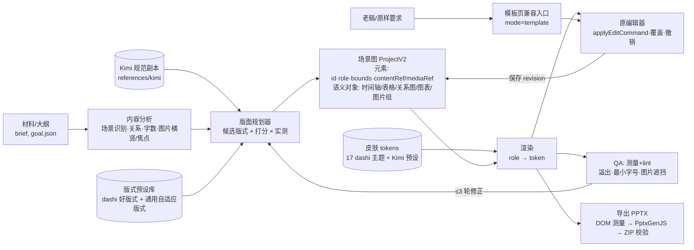

# Dawang-PPT 开发规划 v3

> 日期：2026-10-15｜状态：**计划**（本文无代码改动）｜取代：v2 的执行组织方式与 §3.2「两条线」；v2 的数据契约、编辑契约、导出纪律继续有效。
> 依据：融合规格-v2、实施计划-v2、PPT技能融合方案；`codex/fusion-v1` 已提交代码（至 6b16bec）及其未提交导出 WIP；`grok/fusion-opt-v1`（第一、二轮）；你 10-13、10-14 对 Codex 的原话。

> **执行补充（2026-10-15，用户已确认）**：沿用 `codex/fusion-v1`，不新开分支；原 theme17 外观保留；首次生成保留风格构图差异，并迁移 Kimi 版式与图片规则，换肤时保留手工布局；真实验收稿以桌面《一人多线市场汇报_8页大纲_定稿版》为准；取消 WPS 验收；先以这份八页汇报完成真实闭环，周报及激励稿暂缓；短文字和图片说明按实测高度连续排布，允许记录理由的留白，70% 用于表格、图表和关系主图区。本文下方涉及新分支、统一初始几何、只迁移 tokens 和 WPS 的旧安排，以此补充及开发进度为准。

---

## 0. 结论（先读这一节）

1. **改的是底层，不是加风格。** 新建稿件统一走一条主线：内容分析 → 版面规划 → 场景图（自由定位、带语义角色的元素）→ 主题皮肤 → 原编辑器编辑 → 可编辑 PPTX。dashi 模板页只作为“原样/老稿”兼容入口。
2. **dashi 的好东西全部保留**：原编辑器、制作流程、17 套主题的视觉；好版式改写为“版式预设”（输入内容、输出场景图），参与规划器选择，而不是让内容去撞固定槽位。
3. **Kimi 的东西变成规则，不变成风格**：场景文档、通用规则 → 规划器约束 + lint；Kimi 预设 → 和 dashi 主题同级的皮肤。`kimi/free` 与九宫格第 1 格**降级撤出**。
4. **Codex 的底座是对的，原样保留**：ProjectV2 / revision / 撤销重做 / `applyEditCommand` / 语义对象与覆盖 / DOM 测量导出 / 门槛式验收 / 复用原编辑器。v3 改的是“排版决策放在哪里”和“如何组织开发”。
5. **只用一套门槛：M0–M6 里程碑**，每个都用你的真实稿件（天津汇报重做、58 周报、激励 PPT）在 PowerPoint 与 WPS 里实测通过才算完成。废止 P0–P5 / Task0–8 / 门槛A-B-C 并存的做法。
6. **首个可用版本目标：M3（估计 7–10 个工作日）**——三份真实稿件用新主线做出来、可编辑、可导出。之后再扩模板。

---

## 1. v2 → v3 改了什么、为什么

| 项 | v2 | v3 | 原因 |
|---|---|---|---|
| 页面主线 | §3.2：模板页（layout+props）与组合页（elements）两条线并存；“不把旧组件自动转换成自由画布” | **组合页（场景图）是唯一主线**；模板页只做兼容入口（原样要求/打开老稿） | 你 10-13/10-14 明确要“把 Kimi 的排版逻辑整合进去”，不是“多一个 Kimi 风格”。两条线导致 Kimi 逻辑只作用于少数组合页 |
| 风格 | StyleDefinition 存在，但构图写在 `compose.mjs` 的 `style.id` if 分支里 | 风格 = **token 皮肤 + 偏好版式 + 装饰规则**，全部是数据 | 让同一个规划器服务所有主题；新增主题不改代码 |
| dashi 模板 | 1091 个页面组件原样保留，内容填槽 | 高频页面**分批改写为版式预设**；其余保持兼容入口 | 槽位固定是“死板”和图片横竖不友好的根源 |
| Kimi 设计库 | 迁为“模板家族”（3 个已做） | 场景文档 → 规划约束/lint；预设 → 皮肤 | 避免再变成“加模板” |
| 门槛 | P0–P5、Task0–8、门槛A/B/C 多套并存，无时间线 | **M0–M6 一套**，每个带估计工期和真实稿件验收 | 评审指出门槛过多、真实案例没闭环 |
| 验收 | 以合成样稿、截图为主 | **真实稿件 + PowerPoint/WPS 实测**为完成条件 | 评审指出证据夸大、天津汇报未重做 |
| 表格导出 | 可编辑文字/形状 | 不变：**不做原生表格** | 你已确认不需要原生表格 |

v2 中继续有效（不重写）：§4.1 唯一工程状态、§4.3 手工编辑与自动排版边界、§3.4 测量与 1920×1080 坐标约定、§6 导出纪律。

---

## 2. 目标架构

职责边界：

| 层 | 负责 | 不负责 |
|---|---|---|
| 内容分析 | 事实、关系类型、文字量、图片尺寸/方向/焦点 | 选颜色 |
| 规划器 | 从预设库挑 2–3 个候选，按内容实测打分，选最好的 | 写死坐标 |
| 版式预设 | 输入内容槽 + 区域，输出元素和 bounds；声明适用条件（图数、横竖、字数） | 颜色、字体 |
| 皮肤 | role → 颜色/字体/线条/装饰；背景与氛围 | 改几何 |
| 编辑器 | 改字、换图、拖动缩放、语义增删，全部写覆盖 | 自动重排其他对象 |
| 模型（运行时） | 叙事与逐页任务、在候选中做判断、按 lint 修正 | 绕过约束自由画 |

---

## 3. 各部分怎么做

### 3.1 dashi 模板 → 版式预设 + 皮肤
- **优先级按真实使用频率。** 本机可找到的 29 个 goal.json（含部分 QA/测试稿，样本小，仅供参考）共 120 页：theme14 46 页、theme06 36 页、theme01 11 页、theme13 7 页；高频页为 theme14 page001/007/008/010/011、theme06 page001/071/075/082。首批从这些开始。
- 每个预设做三件事：①抽出区域结构（如 38:62 图文、三列证据、封面大字）为“版式”；②写适用条件（图片数、方向、文字量上下限）；③把颜色/字体/装饰交给该主题皮肤。
- 每个预设与原页面做截图对比；达不到原观感的不上线，继续走兼容入口。
- 主题皮肤：17 个主题各抽一份 tokens（已有 theme17 月白 token 层可作样板）。背景/动效氛围作为皮肤装饰，不进入可编辑业务图形。

### 3.2 Kimi 规则 → 规划约束与 lint
| Kimi 规则（读 references/kimi 原文） | 落点 |
|---|---|
| 场景文档（7 类）：叙事结构、页型偏好、密度 | 规划器输入：候选版式加权、每页文字量上限 |
| 通用规则：禁止卡片堆叠、默认等分、2×2、AI 配色；正文下限 | `design-lint`（已有）作为必过检查 |
| 图片展示方式 | 规划器的图片规则（见 3.4） |
| 时间轴/表格/SmartArt 的表达 | 语义对象的版式选择 |
| 60 个设计预设 | 皮肤（tokens），与 dashi 主题同级可选 |

### 3.3 编辑：统一在场景图上
- 沿用 `applyEditCommand`：改字、换图、几何、语义增删、连接，全部进入撤销/保存。
- **换皮肤**：只换 tokens，几何覆盖保留；**换版式**：重新规划该页，已有覆盖按元素 id 迁移，迁移不了的返回冲突让用户选（沿用 override-orphan 机制），不默认清空。
- 改字后只测量当前元素；放不下时给候选（缩至下限、换版式、拆页），不自动挪其他对象。
- 模板兼容页继续用原编辑器的 props 控件（现状）。

### 3.4 图片处理
- 读取真实宽高与方向（已有 `image-probe`）；**竖图并排成列、横图按空间成行或堆叠、混排按行平衡**（第一轮已在月白实现，推广到所有皮肤）。
- 不拉伸；默认 cover + 焦点。焦点来源：用户指定 > 人脸/主体检测（可选，后做）> 中心。
- **文字不压主体**：全幅图上的文字带只放在焦点外区域；放不下则改图文分栏。
- 缺图：明确占位并在报告中列出，不用无关图填充（天津汇报的问题）。

### 3.5 砍掉/推迟
| 处理 | 项 |
|---|---|
| 撤出 | `kimi/free` 风格、九宫格第 1 格「Kimi 自主设计」（规则并入默认引擎；提交历史保留，不 revert） |
| 推迟 | 原生表格/图表/SmartArt；PPTD 13 类复杂图表（先条形、折线）；人脸/主体检测；任意路径绘图；全部 1091 页迁移 |
| 不做 | 一次性自动转换全部旧模板；为每个 Kimi 预设单独写构图代码 |

---

## 4. 里程碑（唯一门槛体系）

> 工期均为**估计**，按单人连续开发日计；每个里程碑完成 = 表中验收全部满足，并按“计划/本地实现/测试通过/已上线/实测”分列报告。

| 里程碑 | 内容 | 验收（全部满足才算过） | 估计 |
|---|---|---|---|
| **M0 合并与清理** | 合并 Codex 导出 WIP 与 grok 分支（见 §5）；撤出 kimi/free 与九宫格第 1 格；本文定稿 | 全量测试通过；原 17 主题回归截图无新增差异；README/NOTICE 标明私用 | 1–2 天 |
| **M1 风格数据化** | 删除 `compose.mjs` 的 style.id 分支，改为 StyleDefinition 数据（tokens + 偏好版式 + 装饰）；theme14、theme06、theme13、theme17 四个皮肤 | 同一内容在 4 个皮肤下渲染，几何一致、只变外观；现有 6 个风格样稿无回归 | 2–3 天 |
| **M2 通用规划器** | 内容优先规划对所有皮肤生效：文字页、图文、多图（横/竖/混）、时间轴、表格（8 行内）、条形/折线；lint 必过 | 合成全量样例：正文 ≥14pt、无溢出、无拉伸、内容区填充率 ≥70%（不再只占上半页）、lint 0 错误 | 3–4 天 |
| **M3 真实稿件闭环（首个可用版）** | 用新主线重做：①天津汇报（含缺图占位、8 项表格）②一份 58 周报 ③一份激励 PPT | 三份稿：你确认内容无编造；PowerPoint 与 WPS 打开无修复提示、文字可编辑、版式与预览一致；你评审“可用” | 2–3 天 |
| **M4 编辑闭环** | 换皮肤保留覆盖；换版式迁移覆盖/冲突提示；改字溢出候选 | 在 M3 稿上：改字、换图、拖动后换皮肤 → 覆盖仍在；保存重开一致；撤销/重做；导出与预览一致 | 2–3 天 |
| **M5 dashi 预设首批** | theme14、theme06 高频 10–15 页改写为版式预设 | 每个预设与原页截图对比你认可；在 M3 稿中被规划器实际选中且内容不撞槽 | 4–6 天 |
| **M6 扩充（滚动）** | 每批：1–2 个 dashi 主题皮肤 + 5–10 个预设，或 5–10 个 Kimi 预设皮肤 | 每批：一份真实稿件重做 + PowerPoint/WPS 实测 + 迁移状态表更新 | 每批 2–4 天 |

M0–M5 合计估计 **14–21 个工作日**；M3 后即可日常使用（新主线 + 兼容入口并存）。

停止条件：任一里程碑真实稿件不过，不进入下一个；同一问题修正超过 3 轮，停下来报告给你选方案。

---

## 5. 分支与合并

现状：`main`（原版）｜`codex/fusion-v1`（Codex，含未提交导出 WIP：css-paint、字体、外观/DOM 导出测试，约 7 文件 +235/−38）｜`grok/fusion-opt-v1`（基于 6b16bec，8 个本地提交，含 Kimi 原文副本）。

建议：
1. Codex 先在自己的工作区把导出 WIP 提交到 `codex/fusion-v1`（**由 Codex/你来做，我不碰该工作区**）。
2. 新建 `fusion-v3`，从 `codex/fusion-v1` 出发，合并 `grok/fusion-opt-v1`；预计冲突集中在 `export/pptx-core.mjs`、`collect.mjs`（两边都改过导出），解决后跑全量测试。
3. **Kimi 原文的公开风险**：origin 是 GitHub 上的 `mujingquan835/Dawang-ppt`。
   - 方案 A（推荐）：Kimi 原文目录 `references/kimi/` 移出 git，改放本机 `~/.dawang-ppt/kimi-reference/`（或 git 子模块指向一个**私有**仓库），代码按路径读取；这样 `fusion-v3` 可以正常 push、做备份和 review。
   - 方案 B：保持副本在仓库内，`fusion-v3` 只推到私有远端，并启用 `scripts/private-kimi-guard.sh` 作为 pre-push 钩子。
4. 每个里程碑一个或几个小提交：review → 测试 → 提交 →（方案 A 下）push。

---

## 6. 分工（可选）

| 角色 | 负责 | 原因 |
|---|---|---|
| Codex | M0 导出 WIP 收尾、M4 编辑闭环、导出与 PowerPoint/WPS 兼容 | 编辑器、ProjectV2、导出都是 Codex 写的，最熟 |
| Grok | M1 风格数据化、M2 规划器、M5 预设改写、样稿与截图对比 | 第一、二轮已做 token 层、内容优先排版、lint |
| 你 | M3 提供三份真实材料与评审；M5 预设视觉认可；各里程碑验收签字 | 只有你能判断“可用” |

同一时间只允许一方改同一模块；以 `fusion-v3` 为唯一集成分支。

---

## 7. 风险

| 风险 | 影响 | 应对 |
|---|---|---|
| 预设改写后观感变“平”，不如原 dashi | 用户不用新主线 | 截图对比你认可才上线；未达标页继续走兼容入口 |
| 覆盖迁移与自动重排冲突 | 用户修改丢失 | 冲突必提示，不默认清空；M4 专门验收 |
| 导出偏差（DOM 测量、字体回退） | PowerPoint/WPS 与预览不一致 | 每个里程碑都在两款软件实测；字体嵌入/回退记录 |
| 范围膨胀 | 又一轮“做了很多没闭环” | 只按 M0–M6 推进，真实稿件不过不往下走 |
| 模型运行时判断不稳定 | 同一内容排版忽好忽坏 | 规划器给确定性候选 + 实测；模型只在候选内选 |
| Kimi 原文被公开推送 | 版权风险 | §5 方案 A/B |
| 真实材料缺失（如天津汇报缺图） | M3 无法闭环 | 缺图占位并列清单，你补图后再出终稿 |

---

## 8. 需要你确认的决定

| # | 决定 | 选项 | 建议 |
|---|---|---|---|
| D1 | 是否修订 v2 §3.2：组合页成为唯一主线，模板页只做兼容入口 | 修订 / 维持两条线 | **修订**——这是“改底层”的前提 |
| D2 | 撤出 `kimi/free` 与九宫格第 1 格，九宫格只选外观（dashi 主题 + Kimi 预设皮肤） | 撤出 / 保留为选项 | **撤出** |
| D3 | Kimi 原文的存放方式 | A 移出仓库放本机或私有子模块 / B 仓库内 + 只推私有远端 | **A**，可正常 push 与 review |
| D4 | M3 三份真实稿件的材料 | 你指定：天津汇报原材料位置、哪一期 58 周报、哪次激励 PPT | 需你提供；本机按名称没检索到“天津汇报”的 PPT/材料 |
| D5 | 分工 | Codex+Grok 按 §6 / 只由一方开发 | **按 §6**，以 `fusion-v3` 为唯一集成分支 |
